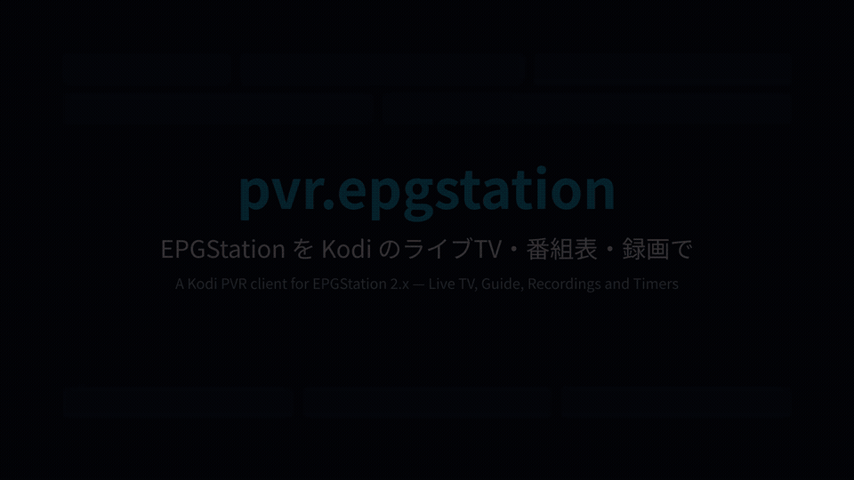

# EPGStation PVR Client for Kodi (`pvr.epgstation`)

Kodi's own TV screens (Live TV, Guide, Recordings, Timers) for
[EPGStation](https://github.com/l3tnun/EPGStation) 2.x, the Japanese ISDB TV recorder that works
with Mirakurun. A binary PVR add-on written in C++ from scratch for Kodi 21 "Omega".

[](https://cdn.jsdelivr.net/gh/MyFeetHurt/kodi-pvr-epgstation@main/media/pvr-epgstation-demo.mp4)

Full video (2:32): [pvr-epgstation-demo.mp4](https://cdn.jsdelivr.net/gh/MyFeetHurt/kodi-pvr-epgstation@main/media/pvr-epgstation-demo.mp4)

> [!NOTE]
> The add-on writes to the EPGStation you configure: it creates and deletes reservations and
> rules, and can delete recordings.

[日本語は下にあります](#日本語)

## Features

- **Live TV** from EPGStation's stream: the original broadcast, or one of EPGStation's
  transcoded modes (setting *Live TV > Stream mode*, e.g. `720p`). Channels in Japanese 3-digit
  numbers (011 NHK総合…), GR/BS/CS groups, radio, logos.
- **Guide** with Japanese genres (as in EPGStation's web UI) and genre colours, full
  descriptions, [新][終][生][初] as Kodi flags. Changes in EPGStation's guide (overruns) reach
  Kodi within about 10 minutes.
- **Recordings**: play and seek, delete (protected recordings are refused), watch a recording
  while it is still recording, and play the encoded file when EPGStation made one (setting
  *Recordings*).
- **Timers**: record a programme from the guide, or by channel and time. Reservations made in
  EPGStation show up too, with their state (scheduled, recording, conflict, skipped).
- **Timer rules**: keyword rules, *Record series* from the guide (the series name is taken from
  the episode title, e.g. `【連続テレビ小説】ひよっこ(48)「…」` → `ひよっこ`), and EPGStation's own
  rules. Rules Kodi's dialog can't show completely (genres, regular expressions, …) are
  read-only in Kodi: enable, disable and delete still work, and nothing is lost.
- Several EPGStation servers: add the add-on more than once (*Add-ons > My add-ons > PVR
  clients > EPGStation PVR Client > Configure > +*).
- English and Japanese.

## Requirements

- EPGStation 2.x (tested with 2.10.0), reachable from Kodi over HTTP.
- Kodi 21 "Omega" on Linux x86_64 (glibc 2.34+: Ubuntu 22.04, Debian 12, Fedora 36 or newer),
  Linux arm64 (built, not yet tested on hardware), Windows 10/11 x64 or Android (Kodi's arm64-v8a,
  armeabi-v7a and x86 APKs; arm64 and x86 tested in the emulator, armeabi-v7a built only).

## Setup

1. Install the repository: download
   [repository.pvr.epgstation-1.0.0.zip](https://raw.githubusercontent.com/MyFeetHurt/kodi-pvr-epgstation/gh-pages/repository.pvr.epgstation-1.0.0.zip) and use
   *Add-ons > Install from zip file* (allow *Unknown sources* when Kodi asks). Then *Install from
   repository > EPGStation PVR Client Repository > PVR clients > EPGStation PVR Client*. Kodi
   installs the build for its platform and updates it with every release.
2. *Configure*: **EPGStation URL**, e.g. `http://192.168.0.10:8888`.
3. *Settings > PVR & Live TV > Guide*: optionally *Use channel numbers from backend*.
4. Japanese text needs a skin font with Japanese glyphs (Estuary: *Interface > Skin > Fonts >
   Arial based*).

## Known limitations

- ARIB captions are not shown (Kodi has no decoder for them).
- No choice between the two audio languages of bilingual (dual mono) broadcasts yet.
- EPGStation can't edit a single reservation; editing a manual timer replaces it.

## Building

Linux, with Kodi's add-on headers (`kodi-addons-dev` on Debian/Ubuntu), CMake, a C++17
compiler and nlohmann-json:

```
tools/build.sh   # -> build/pvr.epgstation/
tools/test.sh    # unit tests (Catch2) of the Kodi-free part in src/epgstation/
```

Portable builds for every platform Kodi 21 runs on (Linux x86_64/arm64 for glibc 2.34+, Windows
x64, Android arm64/armv7/x86) are made in containers with podman (host: Kodi's add-on headers as above): `tools/portable/build.sh`
(Debian 12; MinGW-w64 for UCRT; Android NDK r27c), each checked by `tools/portable/check_*.sh`.

## License

GPL-2.0-or-later, see [LICENSE.txt](LICENSE.txt). Not affiliated with the EPGStation project.

---

## 日本語

EPGStation 2.x を Kodi 標準のテレビ画面（ライブ TV・番組表・録画・タイマー）で使うための PVR
アドオンです。Kodi 21 用に C++ で一から作りました（[デモ動画](https://cdn.jsdelivr.net/gh/MyFeetHurt/kodi-pvr-epgstation@main/media/pvr-epgstation-demo.mp4)、2:32）。

- **ライブ視聴**: 無変換、または EPGStation のトランスコード設定（*ライブ視聴 > 配信モード*、例
  `720p`）。チャンネルは 3 桁番号（011 NHK総合…）、GR/BS/CS グループ、ラジオ、ロゴ。
- **番組表**: EPGStation の Web 画面と同じジャンル名と色分け、番組詳細、[新][終][生][初]。
  延長などの番組表の変更は約 10 分以内に Kodi に反映されます。
- **録画**: 再生・シーク・削除（保護された録画は削除しません）、録画中の追っかけ再生、
  エンコード済みファイルの再生（設定 *録画*）。
- **予約**: 番組表からの単発予約、チャンネルと時刻を指定した予約。EPGStation 側の予約も状態付き
  （予約済み・録画中・競合・除外）で表示されます。
- **ルール**: キーワードルール、番組表からのシリーズ予約（話数やサブタイトルを除いたシリーズ名で
  登録）、EPGStation のルール。Kodi の画面で表せないルール（ジャンル指定など）は読み取り専用で、
  有効・無効の切り替えと削除だけ行えます。
- EPGStation を複数登録できます（アドオンの *設定* で ＋）。

> [!NOTE]
> 設定した EPGStation の予約・ルールの作成と削除、録画の削除を行います。

**インストール**: [repository.pvr.epgstation-1.0.0.zip](https://raw.githubusercontent.com/MyFeetHurt/kodi-pvr-epgstation/gh-pages/repository.pvr.epgstation-1.0.0.zip)
をダウンロードし、*アドオン > zip ファイルからインストール*（「提供元不明のアプリ」を許可）。
続いて *リポジトリからインストール > EPGStation PVR Client Repository > PVR クライアント >
EPGStation PVR Client*。

**設定**: *EPGStation URL*（例 `http://192.168.0.10:8888`）。日本語表示にはスキンのフォントを
日本語対応のもの（Estuary なら *Arial based*）にしてください。

**制限**: ARIB 字幕は表示されません。二か国語放送の音声切り替えは未対応です。

ライセンス: GPL-2.0-or-later。EPGStation プロジェクトとは無関係の非公式アドオンです。
